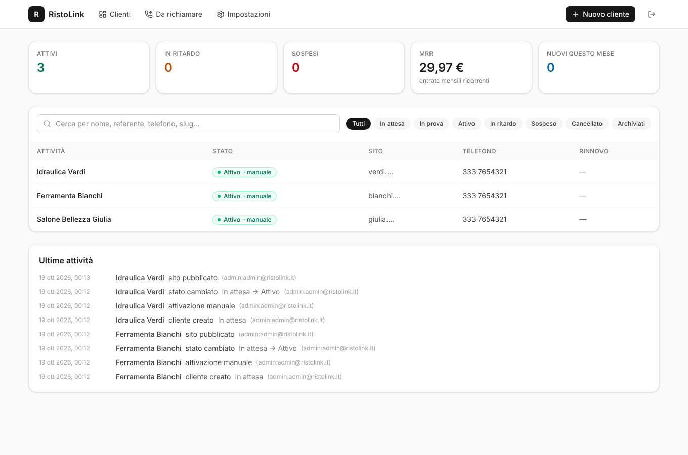
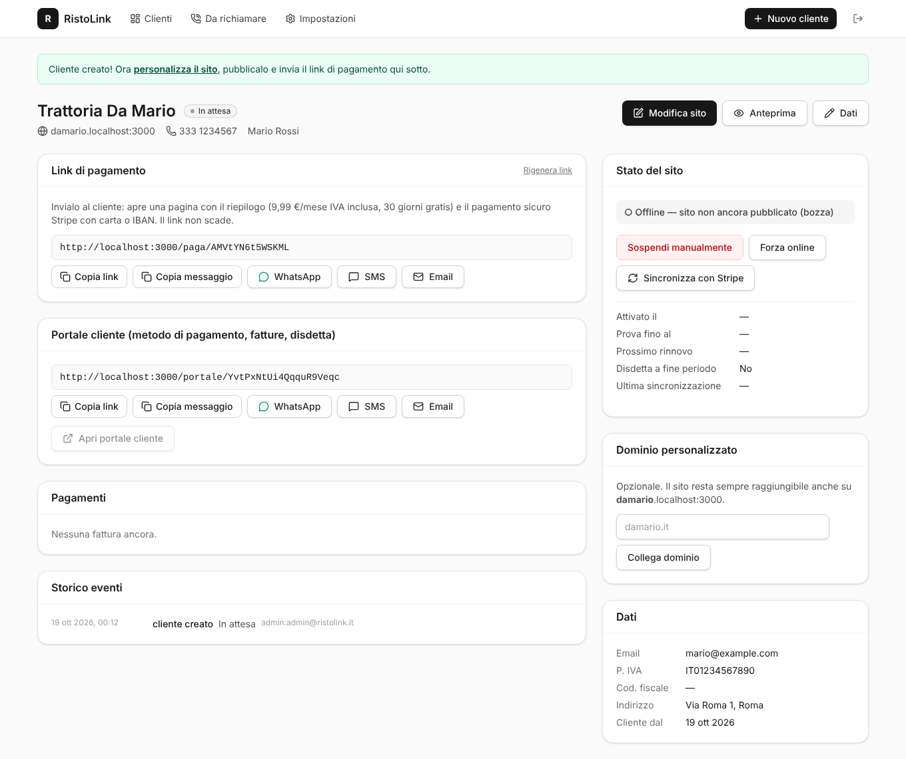
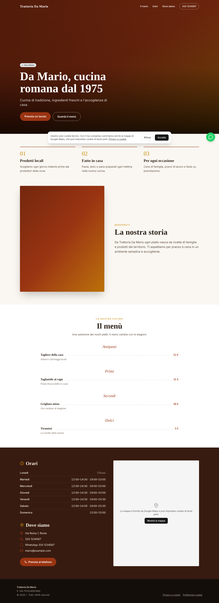
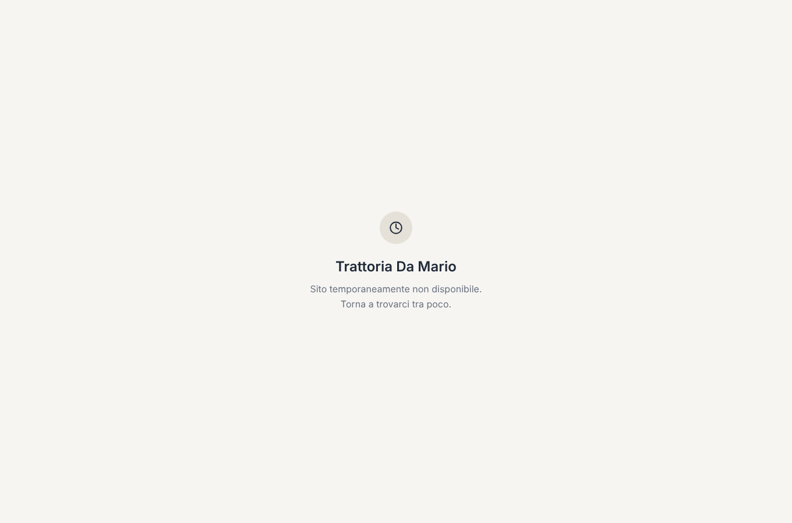

# MioSitoVeloce

Piattaforma multi-tenant per i siti web delle piccole attività locali (ristoranti, parrucchieri, artigiani, negozi).
Modello: **nessun costo iniziale, 9,99 €/mese IVA inclusa**. Se il cliente non paga il sito si sospende da solo,
quando paga torna online da solo.

- `miositoveloce.it` → landing del servizio + link pubblici di pagamento (`/paga/<token>`) e del portale (`/portale/<token>`)
- `admin.miositoveloce.it` → dashboard (solo tu, login protetto)
- `<slug>.miositoveloce.it` → sito del cliente (es. `damario.miositoveloce.it`)
- `damario.it` (opzionale) → stesso sito, su dominio personalizzato del cliente

| Dashboard | Scheda cliente | Sito (ristorante) | Mobile | Sospeso |
|---|---|---|---|---|
|  |  |  |  |  |

Altri template: [beauty](docs/screenshots/10-sito-beauty.png) · [negozio](docs/screenshots/10-sito-negozio.png) · [artigiano](docs/screenshots/10-sito-artigiano.png) · [editor](docs/screenshots/03-editor.png) · [pagina di pagamento](docs/screenshots/04-paga.png) · [da richiamare](docs/screenshots/07-da-richiamare.png)

---

## 1. Architettura

```
                ┌──────────────────────── Vercel (un solo progetto Next.js 16) ───────────────────────┐
 visitatore ──▶ │ src/proxy.ts  (ex "middleware")                                                       │
                │   host → classifyHost()                                                               │
                │   ├─ miositoveloce.it         → landing, /paga, /portale                                  │
                │   ├─ admin.miositoveloce.it   → /admin/*  (+ refresh sessione Supabase)                   │
                │   └─ slug / dominio       → resolve_tenant() [cache 60 s] ─┬─ online  → /tenant/<slug> │
                │                                                           └─ offline → pagina 503 neutra│
                │ /tenant/[slug]  pagina ISR, dati in cache con tag "tenant:<slug>"                     │
                │ /api/stripe/webhook  firma → idempotenza → syncClient()                               │
                │ /api/cron/reconcile  (cron giornaliero) → syncClient() per tutti + archiviazione      │
                └──────────────┬──────────────────────────────────────────────┬────────────────────────┘
                               │                                              │
                     Supabase (Postgres + Auth + Storage, RLS)           Stripe Billing
                     clients · sites · payments · events_log ·           Checkout · Customer Portal ·
                     stripe_events · settings · admins                   Smart Retries · email
```

**Scelte principali**

| Tema | Scelta | Perché |
|---|---|---|
| Framework | Next.js 16 App Router + TypeScript | In Next 16 il middleware si chiama `proxy.ts` (runtime Node). Caching "classico" (`unstable_cache` + ISR + `revalidateTag`), Cache Components disattivati per semplicità. |
| Stato del cliente | **una sola funzione pura** `computeStatus()` (`src/lib/billing/status.ts`) | Webhook, cron e azioni manuali passano tutti da `syncClient()`, che **rilegge sempre l'abbonamento da Stripe** ("fetch-latest"): l'ordine dei webhook non conta e rielaborare un evento è innocuo. |
| Tolleranza | `past_due_since` + `settings.grace_days` | Stripe non emette eventi "al 7° giorno": la sospensione la applica il cron giornaliero. |
| Link di pagamento | `miositoveloce.it/paga/<token>` stabile | Le sessioni Checkout scadono in 24 h; il nostro link non scade, mostra un riepilogo (anteprima carina su WhatsApp) e crea la sessione al clic. Se c'è già un abbonamento attivo apre il portale invece di crearne un secondo. |
| Proxy | solo chiave pubblica + funzione SQL `resolve_tenant()` | Il proxy non vede nessuna tabella: solo slug, nome, stato, pubblicato. Cache in memoria di 60 s (anche per i "non trovato"). |
| Pagina di sospensione | HTML statico dal proxy, **HTTP 503 + Retry-After** | Neutra ("Sito temporaneamente non disponibile"), nessun riferimento ai pagamenti; il 503 dice a Google che è temporaneo. |
| Foto | Supabase Storage (bucket pubblico `site-media`), ridimensionate nel browser a max 1920 px WebP | Siti leggeri senza costi di ottimizzazione immagini. |

**Stati del cliente**

| Stato | Sito | Quando |
|---|---|---|
| `in_attesa` | offline | creato, non ha ancora pagato |
| `trial` | online | prova gratuita in corso |
| `attivo` | online | pagato |
| `in_ritardo` | online | pagamento fallito, entro la tolleranza (default 7 gg); email di promemoria |
| `sospeso` | offline | tolleranza scaduta, abbonamento in pausa o sospensione manuale |
| `cancellato` | offline | disdetto; dopo 90 gg viene archiviato (dati conservati, sparisce dall'elenco) |

Dalla dashboard puoi anche **forzare** uno stato (`Sospendi manualmente` / `Forza online`, es. chi paga in contanti):
la forzatura ha la precedenza su Stripe finché non premi "Riattiva modalità automatica".

### Ordine di sviluppo (come è stato costruito)

1. **Database e auth admin** — `supabase/migrations/…_init.sql`, RLS, `requireAdmin()`. Test: `supabase/tests/rls_test.sql`.
2. **Stripe + webhook + logica di stato** — `src/lib/billing/*`, `src/app/api/stripe/webhook`, `src/app/api/cron/reconcile`. Test: `status.test.ts`.
3. **Proxy multi-tenant e pagina di sospensione** — `src/proxy.ts`, `src/lib/hosts.ts`, `src/lib/tenant/*`. Test: `hosts.test.ts`.
4. **Dashboard** — `src/app/admin/*`, `src/components/admin/*`.
5. **Template ed editor** — `src/components/site/*` (4 template), `src/components/admin/SiteEditor.tsx`.

Ogni fase è stata verificata anche end-to-end in un ambiente locale (Postgres + PostgREST + Stripe finto + Chromium):
login, creazione cliente, checkout, webhook firmati/duplicati/falsi, pagamento fallito → in ritardo → sospeso dal cron →
pagato → online, sospensione manuale, disdetta, archiviazione, 4 template, SEO, cookie banner.

### Struttura

```
src/
  proxy.ts                      smistamento per host (multi-tenant)
  app/
    page.tsx, privacy/          landing miositoveloce.it
    paga/[token], paga/grazie   pagina di attivazione → Stripe Checkout
    portale/[token]             accesso al Customer Portal
    admin/                      dashboard (servita su admin.miositoveloce.it)
      actions.ts                Server Action (tutte verificano l'admin)
      login/  (app)/page.tsx  (app)/clienti/…  (app)/richiamare  (app)/impostazioni
      clienti/[id]/anteprima    anteprima del sito (anche se non pubblicato/non pagato)
    tenant/[slug]/              sito pubblico: pagina, privacy, sitemap.xml, robots.txt
    api/stripe/webhook          webhook Stripe
    api/cron/reconcile          riconciliazione giornaliera
  lib/billing/                  status (logica pura), sync, webhook, checkout, reconcile
  lib/site/                     schema JSON del sito (zod) + contenuti di partenza per template
  components/site/              template ristorante · beauty · negozio · artigiano + parti comuni
supabase/migrations/            schema, RLS, funzioni, bucket
scripts/stripe-setup.mjs        crea prodotto e prezzo su Stripe
```

---

## 2. Setup locale

Requisiti: Node 20+ (consigliato 22), un progetto Supabase (gratuito va bene), un account Stripe, [Stripe CLI](https://docs.stripe.com/stripe-cli).

```bash
npm install
cp .env.example .env.local      # e compila i valori (vedi sotto)
npm run dev
```

Apri (Chrome/Firefox/Edge risolvono da soli `*.localhost`):

- http://localhost:3000 → landing
- http://admin.localhost:3000 → dashboard
- http://damario.localhost:3000 → sito del cliente con slug `damario`

> Safari non risolve `*.localhost`: aggiungi le righe a `/etc/hosts` (`127.0.0.1 admin.localhost damario.localhost`).

Comandi utili: `npm test` (unit test), `npm run typecheck`, `npm run lint`, `npm run build`.

### 2.1 Supabase

1. Crea un progetto su [supabase.com](https://supabase.com) (regione **Frankfurt / eu-central-1**, per il GDPR).
2. **Schema**: SQL Editor → incolla ed esegui `supabase/migrations/20261018000000_init.sql`
   (oppure con la CLI: `npx supabase link --project-ref <ref>` e `npx supabase db push`).
3. **Chiavi** (Project Settings → API Keys) in `.env.local`:
   `NEXT_PUBLIC_SUPABASE_URL`, `NEXT_PUBLIC_SUPABASE_PUBLISHABLE_KEY` (publishable o la vecchia *anon*),
   `SUPABASE_SECRET_KEY` (secret o la vecchia *service_role* — **mai** nel browser, mai con prefisso `NEXT_PUBLIC_`).
4. **Il tuo utente admin**: Authentication → Users → *Add user* (email + password, "Auto confirm"). Poi nel SQL Editor:
   ```sql
   insert into public.admins (user_id, email)
   select id, email from auth.users where email = 'tua@email.it';
   ```
5. **Chiudi le registrazioni**: Authentication → Sign In / Providers → disattiva *Allow new users to sign up*.
   (Anche se qualcuno si registrasse, senza riga in `admins` la RLS non gli mostra nulla e la dashboard lo respinge.)
6. Authentication → URL Configuration → *Site URL*: `https://admin.miositoveloce.it` (in locale `http://admin.localhost:3000`).

**Sicurezza (RLS)**: tutte le tabelle hanno RLS attiva. L'utente anonimo non legge nessuna tabella (solo la funzione
`resolve_tenant`). Un utente autenticato vede/modifica clienti e siti solo se è in `admins`; `payments` e `stripe_events`
sono in sola lettura (li scrive solo il server). Test: `psql … -f supabase/tests/supabase_stub.sql -f supabase/migrations/… -f supabase/tests/rls_test.sql` su un Postgres vuoto.

---

## 3. Configurazione Stripe (prima in modalità TEST)

Tutto quanto segue va fatto **con il toggle "Test mode" attivo**; quando funziona, ripeti in Live (prodotti, prezzi,
webhook e impostazioni sono separati tra test e live).

1. **Prodotto e prezzo** — `STRIPE_SECRET_KEY=sk_test_… npm run stripe:setup` stampa `STRIPE_PRICE_ID=price_…`.
   (A mano: Product catalog → Add product "Sito web MioSitoVeloce" → prezzo ricorrente 9,99 EUR mensile,
   *Include tax in price: Sì*.)
2. **Metodi di pagamento** — Settings → Payments → Payment methods: attiva **Cards** e **SEPA Direct Debit**.
   Il Checkout li filtra con `allowed_payment_method_types: ["card", "sepa_debit"]`.
3. **IVA** — il prezzo è "IVA inclusa". Per l'emissione delle fatture con IVA esposta puoi attivare Stripe Tax
   (Settings → Tax) oppure gestire la fatturazione elettronica (SDI) col tuo commercialista: le ricevute Stripe non sono
   fatture elettroniche italiane.
4. **Webhook** — Developers → Webhooks → *Add endpoint*: `https://admin.miositoveloce.it/api/stripe/webhook`
   (funziona su qualsiasi host del progetto), eventi:
   ```
   checkout.session.completed
   checkout.session.async_payment_succeeded
   checkout.session.async_payment_failed
   invoice.paid
   invoice.payment_failed
   invoice.payment_action_required
   invoice.finalized
   invoice.voided
   invoice.marked_uncollectible
   customer.subscription.created
   customer.subscription.updated
   customer.subscription.deleted
   customer.subscription.paused
   customer.subscription.resumed
   ```
   Copia il *Signing secret* (`whsec_…`) in `STRIPE_WEBHOOK_SECRET`.
5. **Customer Portal** — Settings → Billing → Customer portal: attiva *Aggiorna metodi di pagamento*,
   *Cronologia fatture*, *Aggiorna informazioni di fatturazione* (email, indirizzo, partita IVA) e
   *Annulla abbonamenti* → "Alla fine del periodo di fatturazione". Lingua: italiano. Salva (crea la configurazione di default).
6. **Smart Retries e pagamenti falliti** — Settings → Billing → Subscriptions and emails → *Manage failed payments*:
   - **Smart Retries**: attivi, ad es. 8 tentativi in 2 settimane;
   - dopo l'ultimo tentativo: **"Mark the subscription as unpaid"** (consigliato: l'abbonamento resta recuperabile, noi
     sospendiamo comunque il sito al 7° giorno; se il cliente paga la fattura aperta torna `active` e il sito riparte).
     Se scegli "Cancel the subscription", il cliente dovrà riattivarsi dal link di pagamento.
   - attiva l'uso del nuovo metodo di pagamento per ritentare le fatture scadute.
7. **Email automatiche** (stessa pagina): attiva *Send emails about failed payments* con link per aggiornare il
   pagamento, *Send reminders when trials are ending* e (Settings → Customer emails) *Successful payments* per le ricevute.
   In aggiunta l'app manda un **suo** promemoria quando un cliente va "in ritardo" e quando viene sospeso, se imposti
   `RESEND_API_KEY` (con `ADMIN_NOTIFY_EMAIL` ricevi anche tu una notifica a ogni cambio di stato).
8. **Branding** (Settings → Branding): logo e colori per Checkout, portale e email.

### 3.1 Testare i webhook in locale con Stripe CLI

```bash
stripe login
npm run stripe:listen          # = stripe listen --forward-to localhost:3000/api/stripe/webhook
# copia il whsec_… stampato in STRIPE_WEBHOOK_SECRET (.env.local) e riavvia npm run dev
```

Flusso completo:

1. Crea un cliente su http://admin.localhost:3000 → *Nuovo cliente*, personalizza il sito e spunta *Pubblicato*.
2. Copia il **link di pagamento**, aprilo, premi *Attiva*: si apre Stripe Checkout.
3. Paga con la carta di test `4242 4242 4242 4242` (scadenza futura, CVC qualsiasi) oppure SEPA con IBAN `DE89370400440532013000`.
4. Nel terminale di `stripe listen` vedi gli eventi (`checkout.session.completed`, `invoice.paid`…); il cliente passa ad
   *Attivo* e `http://<slug>.localhost:3000` va online (entro 60 s per la cache del proxy).

Gli eventi ricevuti, con esito ed eventuali errori, sono in Dashboard → **Impostazioni → Ultimi webhook Stripe**
(tabella `stripe_events`). Un evento già elaborato viene ignorato (idempotenza); se l'elaborazione fallisce l'endpoint
risponde 500 e Stripe ritenta.

### 3.2 Simulare un pagamento fallito

**Metodo consigliato: Test clock** (simula il passare del tempo)

1. Developers → **Test clocks** → crea un orologio, e al suo interno un cliente con la carta
   `4000 0000 0000 0341` (si salva correttamente ma ogni addebito successivo **fallisce**).
2. Crea l'abbonamento al prezzo MioSitoVeloce per quel cliente.
3. Collega il cliente MioSitoVeloce: copia il `cus_…` in `clients.stripe_customer_id` (SQL Editor) oppure, più semplice,
   crea il cliente in dashboard, paga dal link con la carta `4242…`, poi nel portale cliente sostituisci la carta con `4000 0000 0000 0341`.
4. Fai avanzare l'orologio oltre la data di rinnovo: arriva `invoice.payment_failed` → il cliente diventa **In ritardo**
   (compare in *Da richiamare*, parte il promemoria).
5. Per vedere la sospensione senza aspettare 7 giorni: in *Impostazioni* metti la tolleranza a 0 giorni (oppure
   `update clients set past_due_since = now() - interval '8 days' where slug='…'`) e lancia il cron a mano:
   ```bash
   curl -H "Authorization: Bearer $CRON_SECRET" http://localhost:3000/api/cron/reconcile
   ```
   → **Sospeso**, il sito mostra la pagina neutra.
6. Paga la fattura aperta (Stripe Dashboard → fattura → *Charge customer* dopo aver messo una carta `4242…`):
   arriva `invoice.paid` → **Attivo**, sito di nuovo online.

**Metodo rapido** (solo per vedere la reazione del webhook): `stripe trigger invoice.payment_failed`.
Crea però un cliente Stripe nuovo, non collegato a nessun cliente MioSitoVeloce: nel log vedrai "cliente non trovato".

Altre carte utili: `4000 0025 0000 3155` (richiede 3D Secure), `4000 0000 0000 9995` (fondi insufficienti al primo pagamento).

### 3.3 Passaggio in produzione (LIVE)

Ripeti i punti 1-8 in Live, poi su Vercel (ambiente *Production*) sostituisci `STRIPE_SECRET_KEY` (`sk_live_…`),
`STRIPE_PRICE_ID` (price live) e `STRIPE_WEBHOOK_SECRET` (dell'endpoint live). In *Impostazioni* della dashboard il
controllo "Stripe" mostra se sei in TEST o LIVE.

---

## 4. Deploy su Vercel

1. Importa il repository su [vercel.com/new](https://vercel.com/new) (framework Next.js rilevato in automatico).
2. Settings → Environment Variables: tutte quelle di `.env.example`, con `NEXT_PUBLIC_ROOT_DOMAIN=miositoveloce.it`.
   Genera `CRON_SECRET` con `openssl rand -hex 32`.
3. **Cron**: `vercel.json` esegue `/api/cron/reconcile` ogni giorno alle 03:17 UTC. Vercel invia da solo
   `Authorization: Bearer $CRON_SECRET`. (Sul piano Hobby i cron sono giornalieri: va benissimo.)
4. Region delle funzioni: Settings → Functions → **Frankfurt (fra1)**, vicino a Supabase.
5. Dopo il primo deploy aggiungi i domini (sezione 5) e aggiorna l'URL del webhook Stripe.
6. Facoltativo: per collegare in automatico i domini dei clienti dalla dashboard imposta `VERCEL_API_TOKEN`
   (vercel.com/account/tokens), `VERCEL_PROJECT_ID` (Settings → General) ed eventualmente `VERCEL_TEAM_ID`.

---

## 5. DNS: wildcard `*.miositoveloce.it` e domini personalizzati

### Conviene spostare i nameserver? **Sì, su Vercel.**

Per un dominio **wildcard** Vercel deve emettere un certificato SSL `*.miositoveloce.it`, e Let's Encrypt lo rilascia solo
con la verifica DNS-01: Vercel può farla in automatico **solo se il dominio usa i nameserver di Vercel**.
Con un semplice CNAME presso un altro provider (Aruba, Register, GoDaddy…) il wildcard non ottiene il certificato.

- **Cloudflare**: sconsigliato *davanti* a Vercel. Con il proxy arancione attivo si sommano due CDN, Vercel non vede il
  traffico reale e il certificato wildcard non si rinnova; in modalità "DNS only" resti comunque senza DNS-01 automatico.
  Si può fare (certificato edge Cloudflare + "Full (strict)"), ma è più complicato e non porta vantaggi qui.
- **Vercel DNS**: gratuito, certificati automatici per apex, `www`, `admin` e tutti i sottodomini dei clienti.

### Passo passo

1. Vercel → Project → Settings → **Domains** → aggiungi, nell'ordine:
   - `miositoveloce.it`
   - `www.miositoveloce.it` → scegli *Redirect to* `miositoveloce.it` (308)
   - `admin.miositoveloce.it`
   - `*.miositoveloce.it`
2. Vercel indicherà di usare i suoi nameserver. **Prima di cambiarli**, in Vercel → *Domains* (dashboard account) →
   `miositoveloce.it` → **DNS Records**, ricrea i record che hai già presso il provider e che vuoi conservare, in
   particolare **la posta** (MX, SPF `TXT v=spf1 …`, DKIM, DMARC) e le eventuali verifiche (Google, ecc.).
   Se cambi i nameserver senza ricrearli, **le email su @miositoveloce.it smettono di funzionare**.
3. Dal pannello del tuo registrar (dove hai comprato miositoveloce.it) → *Gestione DNS / Nameserver* → sostituisci con:
   ```
   ns1.vercel-dns.com
   ns2.vercel-dns.com
   ```
4. Attendi la propagazione (di solito 1-2 ore, fino a 48). In Vercel → Domains i quattro domini diventano
   *Valid Configuration* e i certificati vengono emessi da soli. Verifica: `dig NS miositoveloce.it` e apri
   `https://prova.miositoveloce.it` (deve mostrare "Sito non trovato", segno che il wildcard funziona).
5. Se usi Resend per le email, aggiungi in Vercel DNS i record che Resend ti indica per `miositoveloce.it`.

> Se proprio non vuoi spostare i nameserver: puoi aggiungere a mano ogni sottodominio (`damario.miositoveloce.it` →
> CNAME `cname.vercel-dns.com` e aggiungerlo in Vercel). Funziona, ma va fatto per ogni nuovo cliente.

### Domini .it: nameserver bloccati? (es. IONOS "Aggiornamento in corso")

Il Registro .it accetta nuovi nameserver solo se rispondono già per il dominio, ma Vercel crea la zona DNS
solo dopo che i nameserver puntano a lui: i due controlli si bloccano a vicenda. In questo caso **lascia i DNS
dal provider** (es. IONOS) e crea lì questi record:

| Tipo | Nome | Valore |
|---|---|---|
| A | `@` | `76.76.21.21` |
| CNAME | `www` | `cname.vercel-dns.com` |
| CNAME | `admin` | `cname.vercel-dns.com` |
| CNAME | `*` | `cname.vercel-dns.com` |

Senza nameserver Vercel il certificato wildcard non viene emesso: per questo, con `VERCEL_API_TOKEN` e
`VERCEL_PROJECT_ID` impostati, la dashboard **aggiunge in automatico al progetto Vercel il sottodominio di ogni
nuovo cliente** (es. `damario.miositoveloce.it`), che riceve così il suo certificato SSL in pochi minuti.

### Domini personalizzati dei clienti (es. `damario.it`)

1. Nella scheda cliente → *Dominio personalizzato* → `damario.it` → **Collega dominio**.
   - Con `VERCEL_API_TOKEN` configurato il dominio (e `www.damario.it` in redirect) viene aggiunto al progetto Vercel
     in automatico e puoi premere *Verifica DNS*.
   - Senza token: aggiungilo tu in Vercel → Settings → Domains.
2. Presso il provider DNS del cliente imposta:

   | Tipo | Nome | Valore |
   |---|---|---|
   | A | `@` | `76.76.21.21` |
   | CNAME | `www` | `cname.vercel-dns.com` |

   (se Vercel mostra un valore CNAME/A specifico per il progetto, usa quello). Se il dominio è già usato su un altro
   account Vercel ti verrà chiesto anche un record `TXT _vercel` di verifica.
3. Appena i DNS puntano a Vercel il certificato SSL è automatico. Il sito resta raggiungibile anche su
   `damario.miositoveloce.it`; il tag canonical punta al dominio personalizzato per evitare contenuti duplicati su Google.
4. Le email del cliente (MX) non vanno toccate: si cambiano solo `@` e `www`.

---

## 6. Uso quotidiano: un sito nuovo in 15 minuti

1. **Nuovo cliente** (2 min): nome attività (lo slug si genera da solo, con controllo di unicità e parole riservate),
   telefono, email, P. IVA, template. Il sito nasce già pieno di testi di esempio del settore.
2. **Modifica sito** (10 min): copertina e foto (caricate dal telefono, ridimensionate in automatico), testi, servizi/menù
   con prezzi, orari (con "copia su tutti i giorni"), contatti, colori (palette pronte), SEO. *Salva e anteprima*.
3. Spunta **Pubblicato** e invia il **link di pagamento** con il pulsante WhatsApp/SMS/Email (messaggio già scritto).
4. Quando il cliente paga, il sito va online da solo. Da lì: KPI in dashboard, lista **Da richiamare** per chi è in
   ritardo (telefono e WhatsApp cliccabili), storico pagamenti ed eventi nella scheda.

---

## 6b. Siti "HTML personalizzato" (creati a parte, es. in chat con Claude)

Oltre ai 4 template puoi pubblicare una **pagina HTML completa** fatta su misura.

- **Nuovo cliente** → Template: *HTML personalizzato*. Viene creata una pagina di partenza col nome dell'attività.
- **Modifica sito** → *Tipo di sito: HTML personalizzato*: incolla l'HTML o carica il file `.html`. A fianco vedi
  l'anteprima dal vivo. Le foto caricate nella sezione "Foto da usare nell'HTML" hanno un link pubblico da usare
  nei tag ``.
- Si può anche chiedere a Claude in chat di creare il sito: lo salva direttamente nel database
  (`sites.custom_html`, con `html_mode = true`) e compare online entro circa 5 minuti.
- Abbonamento, sospensione (pagina neutra), dominio personalizzato, `/privacy`, `sitemap.xml` e `robots.txt`
  funzionano come per gli altri siti. Se la pagina non contiene un link a `/privacy`, in fondo viene aggiunta
  in automatico una riga con nome, P. IVA e link "Privacy e cookie".
- Limite 2 MB per pagina; l'HTML può contenere CSS e JavaScript. Spegnendo l'opzione si torna al template, che
  resta salvato.

## 7. Variabili d'ambiente

Tutte documentate in [`.env.example`](.env.example). Riassunto:

| Variabile | Obbligatoria | Note |
|---|---|---|
| `NEXT_PUBLIC_ROOT_DOMAIN` | sì | `miositoveloce.it` (locale `localhost:3000`) |
| `NEXT_PUBLIC_SUPABASE_URL`, `NEXT_PUBLIC_SUPABASE_PUBLISHABLE_KEY` | sì | chiave pubblica |
| `SUPABASE_SECRET_KEY` | sì | solo server |
| `STRIPE_SECRET_KEY`, `STRIPE_WEBHOOK_SECRET`, `STRIPE_PRICE_ID` | sì | test → live |
| `STRIPE_PORTAL_CONFIG_ID` | no | portale dedicato (utile se l'account Stripe è condiviso) |
| `CRON_SECRET` | sì | protegge il cron |
| `RESEND_API_KEY`, `EMAIL_FROM`, `ADMIN_NOTIFY_EMAIL` | no | email proprie |
| `VERCEL_API_TOKEN`, `VERCEL_PROJECT_ID`, `VERCEL_TEAM_ID` | no | domini automatici |
| `NEXT_PUBLIC_CONTACT_PHONE`, `NEXT_PUBLIC_CONTACT_EMAIL`, `NEXT_PUBLIC_COMPANY_INFO` | no | landing |
| `TENANT_CACHE_TTL_SECONDS` | no | cache del proxy (default 60) |
| `ADMIN_HOSTS` | no | host extra che aprono la dashboard (es. l'URL `*.vercel.app` del progetto) |
| `STRIPE_API_HOST` | no | solo per test con [stripe-mock](https://github.com/stripe/stripe-mock) |

---

## 8. Note e limiti noti

- **Cache del proxy**: dopo un pagamento il sito torna online entro ~60 s (il TTL della cache in memoria per istanza).
  I contenuti modificati dall'editor invece sono visibili subito (invalidazione per tag).
- **Privacy e cookie**: informativa e banner sono un modello di base generato dai dati del cliente (nessun cookie di
  profilazione; Google Maps caricato solo dopo il consenso). Fai verificare i testi da un consulente.
- **Fatturazione elettronica**: Stripe non invia fatture allo SDI; valuta un'integrazione (es. Fatture in Cloud) o la
  gestione col commercialista.
- La sospensione manuale ferma solo il sito, non l'addebito: per interrompere i pagamenti disdici l'abbonamento su Stripe.
